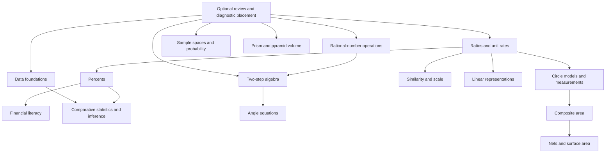

# Grade 7 game curriculum and skill-tree design

Scope: standard Texas Grade 7 mathematics, 19 TAC §111.27(b). Advanced Grade 7 is excluded. Reviewed November 17, 2026. This is a game-design decomposition, not official wording, a pacing guide, or a claim that the game already teaches every expectation.

## Evaluation of the proposed catalog

The proposed list is a strong starting inventory. It spans the content domains, but “exhaustive” should mean every expectation has explicit evidence requirements, not that every possible exercise has been listed. Several bullets are formats or difficulty variants of the same skill. Treating all of them as independent unlocks would produce a large, brittle progression.

The revision uses 69 concept nodes, including 15 optional review nodes, with required exercise variants inside each node. The [full tree and coverage index](docs/curriculum/skill-tree.md) is the revised catalog; [the JSON catalog](docs/curriculum/skill-tree.json) contains the same nodes and dependency edges for implementation. It maps all 43 content expectations in 7.2–7.13; 7.1A–G is cross-cutting evidence. The alignment is a design target, not a coverage claim for existing problems.

### Changes to the submitted list

| Decision | Adjustment |
|---|---|
| Make compound probability explicit | Require compound theoretical and experimental calculations and predictions, beyond merely listing compound outcomes. |
| Add simulation execution | Selecting a plausible simulation is insufficient: students must run or use physical and technological simulations and interpret the results. |
| Make representation creation explicit | Include constructed lists, trees, scale drawings, tables, graphs, equations, and original matching stories. Recognition questions are useful practice but do not establish creation evidence. |
| Specify solid coverage | Require rectangular and triangular prisms and rectangular and triangular pyramids for nets and surface area, with lateral and total area separately evidenced. |
| Specify volume-model coverage | Include both rectangular and triangular prism–pyramid relationships, with verbal and symbolic explanation. A memorized one-third formula is insufficient model evidence. |
| Clarify similarity | Test corresponding angles and both within-figure and between-figure ratios; include nonexamples. |
| Strengthen financial records | Require organizing records and constructing a net worth statement, rather than only classifying items or subtracting totals. |
| Strengthen budgets | Include taxes and all three planned savings purposes. Use the stated total budget as the denominator for category percentages; identify whether the problem assumes the entire income is allocated. |
| Strengthen estimator tasks | Supply a dated local estimator or dataset with household assumptions, then require its use and a wage calculation. A generic division question alone is incomplete evidence. |
| Move prerequisites to optional review | Number ordering, opposites, absolute value, basic conversions, simple expression manipulation, single-distribution summaries, basic area, and one-step algebra remain available without being labeled new Grade 7 content. |
| Add missing review bridges | Coordinate-plane reading, one-step equations/inequalities, quartiles and IQR, and distinguishing expressions from equations help the proposed branches work. |
| Merge repeated evidence | Population inference aligns to both 7.6F and 7.12B. Sales, discounts, rates, and financial applications can share generators while retaining distinct concept and context evidence. |
| Keep useful elaborations | Reverse circle questions, percent-original-value problems, and contextual integer solutions are worthwhile variants; they are not separate official expectations. |

Use a stated convention for natural numbers, because inclusion of zero varies. The main set diagram must still show whole numbers inside integers inside rational numbers. Never generate division by zero. Keep within-system conversions as review and explicitly include between-system conversions in Grade 7.

The prior repository curriculum had incorrect expectation numbers, cylinder volume, and Grade 6 financial topics presented as Grade 7. This document replaces that scope. Cylinder volume, checking registers, credit reports, college-payment methods, and career/lifetime-income comparisons do not belong in this standard Grade 7 core catalog.

## Workable progression

Use a directed acyclic graph displayed as branches, not a single path that forces every child through basic facts. The teacher can open any node, assign review independently, or accept diagnostic evidence for prerequisites. Cross-branch prerequisites mean “recommended preparation.” They never require spending coins or obtaining a random reward.

This overview collapses several review edges. The JSON is authoritative for exact recommended prerequisites. Coordinates are display choices, not dependencies. Show a small set of recommended next nodes and allow inspection of the full tree.

Each node has three missions: learn with support, practice varied examples, and demonstrate independently. These are modes of the same concept, not separate skills. A branch challenge samples several concepts but awards evidence to each relevant node rather than creating another mastery track.

Multiplication families 0–12 and division families 1–12 remain independently assignable children of the review nodes. Persist family-level evidence using a variant key, for example `family:7`. Preserve the existing per-family IDs through an explicit migration map. Number size, signs, denominator complexity, missing operand, and context are item parameters, not extra map nodes.

## Mastery and access

Keep access, mastery, and game rewards separate:

- Access: teacher assignment, diagnostic placement, or suggested progression.
- Evidence: calculation, application, representation, and reasoning dimensions, each with a count and accuracy or rubric result. Only dimensions relevant to that concept are required.
- Game state: XP, coins, card level, damage, chest rewards, and battle performance.

Initial mastery proposal, to be calibrated with students: ten recent independent scored items across at least two sessions, at least 80% correct overall, and at least two successful observations in each required dimension. Require coverage of every required variant before displaying “catalog coverage complete”; a single full-node mastery score must not hide untested operations, solid types, or representations. Track variant evidence separately and show remaining coverage to the teacher. Use independent transfer tasks for representation creation and reasoning; do not count a matching question as constructed evidence. Teacher-scored tasks remain pending until reviewed.

These thresholds are product defaults, not TEKS requirements or a validated assessment model. Store evidence per dimension and variant so thresholds can change without rewriting historical attempts. Hint-assisted answers count as practice, not independent mastery. Never infer mastery from purchased upgrades, chest unlocks, speed, or timeouts. Track fluency speed separately for suitable arithmetic tasks; reasoning and creation missions are untimed by default. A missed review item recommends help without globally locking Grade 7 content.

## Implementation contract

The JSON is design data only and is intentionally separate from `lib/progression-map.json`, which currently describes battle worlds and operation-based missions. Do not replace that battle file with this catalog.

Each catalog node contains a stable ID, branch, scope, recommended prerequisites, TEKS links, and required variants. Branch format lists are capability requirements, not a claim that every node uses every format. Next, author a problem-template manifest with exact per-template formats, dimensions, variant keys, grading policies, examples, and difficulty bounds. The prose variant checklists must become explicit machine keys before coverage tracking ships.

A future problem instance needs:

- `instanceId`, `templateId`, template version, catalog version, primary concept ID, secondary concept IDs, and variant keys.
- A discriminated prompt payload: text plus optional diagram, graph, table, net, or simulation data.
- A discriminated response: scalar, rational, choice IDs, ordered IDs, equation, graph objects, drawing, structured record, or explanation.
- Evaluation policy: exact rational equality, accepted choice set, symbolic equivalence, graph constraints, numerical tolerance, or teacher rubric.
- Context, representation, process-standard tags, required evidence dimensions, hints used, and independent/assisted status.

Keep prompt representations separate from response formats: a diagram may accept a numeric answer, while a graph-creation task must accept graph objects. Normalize fractions, decimals, and mixed numbers to exact rational values where appropriate. Specify units, whether units are supplied or assessed, π convention, and rounding in each template. Do not round each compound-interest step unless the stated policy calls for it. Store original student input as well as normalized values.

Attempts need the immutable problem snapshot or reproducible seed plus template version, structured response, per-dimension grading, rubric version, assistance, timing, assignment, and review status. Server-side grading and authorization are required before responses can award persistent mastery or rewards. Client-side expected answers alone must not be trusted.

Add concept progress and teacher assignment tables alongside existing game records. Retain legacy attempts and per-family progress with provenance; import only the evidence actually recorded. Existing card levels do not establish curriculum mastery. Make reward events idempotent so retries cannot duplicate progress or coins.

### Current constraints and next implementation slices

The current `Problem` type in `lib/gameplay.ts` assumes four operations, operands, and a numeric answer. `app/play/page.tsx` renders a digit-only keypad. `lib/database.types.ts` also stores numeric expected and student answers. All three require extension before broad Grade 7 coverage is possible.

1. **Catalog foundation:** validate IDs and dependency edges; add teacher assignment and diagnostic bypass; preserve existing gameplay and progress. Convert the variant checklists into keyed template requirements. Add fixtures covering representative templates and grading edge cases.
2. **Numeric pilot:** add signed, decimal, and rational response controls; introduce rational-number templates, percent templates, and two-step-equation numeric solutions. Test zero, negative values, equivalent fractions, units, and rounding. Show only supported missions as playable.
3. **Choice and visual prompts:** accessible choices plus tables, diagrams, graphs, nets, and tree rendering. Add graph-reading, similarity, and solid-measurement practice. Label recognition evidence accurately.
4. **Constructed representations:** keyboard-accessible sorting, number lines, equation entry, graph/table editors, scale drawings, nets, and structured budget/financial-record editors. Add physical-simulation recording, interactive simulations, and a sourced estimator dataset or integration.
5. **Reasoning and complete coverage:** explanation collection, teacher rubric review, variant coverage reports, mixed branch challenges, and transfer tasks. Audit every expectation against authored, playable, graded evidence before claiming full coverage.

Definition of ready for implementation: the catalog and graph are available now. Definition of a shipped concept: templates, accessible response controls, grading rules, persistence, teacher visibility, and required evidence all work. Definition of full Grade 7 coverage: every required content variant and process dimension has authored and reviewed evidence; numeric-only launch phases cannot claim it.

## Sources and alignment limits

The controlling source is [TEA's current Chapter 111 index](https://tea.texas.gov/laws-and-rules/texas-administrative-code/19-tac-chapter-111), specifically §111.27(b), with [the official Subchapter B PDF](https://tea.texas.gov/laws-and-rules/sboe-rules-tac/sboe-tac-currently-effect/ch111b.pdf), printed pages 6–9. Consult those for the exact legal wording. All node names, grouping, dependencies, mission structures, thresholds, and implementation choices here are design recommendations. The advanced course has a separate listing and is outside this catalog.
